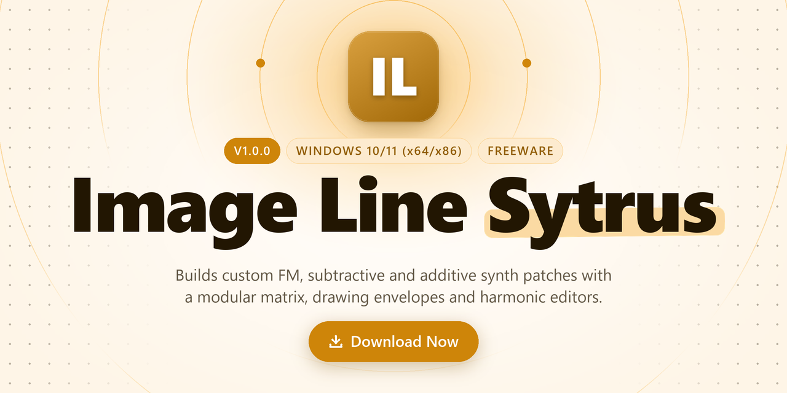

<h1 align="center">Image Line Sytrus - FM Synthesizer Workstation for Windows 10/11</h1>

<p align="center"><i>Sytrus is a hybrid FM, subtractive and additive synthesizer used by sound designers and producers to build patches through a modular matrix, drawn envelopes and harmonic editors. This page documents requirements, patch configuration paths, engine modes, shortcuts, CLI flags and Windows troubleshooting.</i></p>

<p align="center">&nbsp;&nbsp;&nbsp;&nbsp;&nbsp;&nbsp;&nbsp;&nbsp;</p>

<p align="center"></p>

<p align="center">
  <a href="https://quietbig.github.io/image-line-sytrus/">
    <picture>
      <source media="(prefers-color-scheme: dark)" srcset="./assets/Click-dark.svg">
      
    </picture>
  </a>
</p>

## Table of Contents

<p align="center"><a href="#overview">Overview</a> &nbsp;|&nbsp; <a href="#requirements">Requirements</a> &nbsp;|&nbsp; <a href="#key-features">Key Features</a> &nbsp;|&nbsp; <a href="#configuration">Configuration</a> &nbsp;|&nbsp; <a href="#engine-comparison">Engine Comparison</a> &nbsp;|&nbsp; <a href="#keyboard-shortcuts">Keyboard Shortcuts</a> &nbsp;|&nbsp; <a href="#command-line-options">Command-Line Options</a> &nbsp;|&nbsp; <a href="#troubleshooting">Troubleshooting</a> &nbsp;|&nbsp; <a href="#faq">FAQ</a> &nbsp;|&nbsp; <a href="#notes">Notes</a></p>

## Overview

Sytrus runs as a VST2/VST3 instrument inside a host DAW or as a standalone patch editor, and exposes its full synthesis graph in a single window for operators who need repeatable, inspectable results.

### What It Does

Sytrus generates sound from up to six operator modules wired through a routing matrix, each operator switchable between FM, subtractive and additive synthesis. The matrix lets you define modulation depth and output taps per operator pair, while the envelope and harmonic editors let you shape both amplitude and spectrum over time.

### Who It Is For

Sound designers, preset authors and producers who want fine control over modulation routing rather than a fixed-architecture synth. It is also used by DAW administrators who stage shared preset banks for a studio or lab.

### What Ships in the Build

The installer deploys the standalone editor, the VST3 plugin, the legacy VST2 DLL, a factory preset bank, and a `sytrus-cli.exe` helper for batch preset validation. Presets are written as `.fxp` and Sytrus-native `.sytrus` files.

## Requirements

| Spec | Minimum | Recommended |
|------|---------|-------------|
| OS | Windows 10 1809 (x64) | Windows 11 23H2 (x64) |
| CPU | Dual-core 2.0 GHz, SSE2 | Quad-core 3.0 GHz or faster |
| RAM | 2 GB | 8 GB |
| GPU or display | 1280x720, 32-bit color | 1920x1080, 100% DPI scaling |
| Storage | 250 MB free | 1 GB free (preset banks and caches) |
| Host format | VST3 capable DAW | VST3 64-bit DAW with MIDI 2.0 support |

## Key Features

* **Modular Routing Matrix** , connects up to six operators with per-pair modulation depth and output taps.
* **Drawn Envelopes** , edit multi-stage amplitude and modulation curves by dragging control points directly.
* **Harmonic Editor** , sculpt additive partials per operator with a drawable spectrum and preset harmonic shapes.
* **Hybrid Operator Mode** , switches each operator between FM, subtractive and additive synthesis without rebuilding the patch.
* **Filter and FX Chain** , inserts per-voice filters, chorus, delay and reverb inside the matrix output path.
* **Preset Bank Management** , saves and reloads `.sytrus` and `.fxp` banks with per-patch metadata.
* **MIDI Learn and Macro Binding** , maps host automation and CC messages to matrix depth and envelope stages.
* **Batch Preset Validation** , verifies patch integrity through `sytrus-cli.exe` before deployment to a shared bank.

## Configuration

| Path | Purpose |
|------|---------|
| `%APPDATA%\ImageLine\Sytrus\settings.ini` | User preferences, DPI mode, update channel |
| `%APPDATA%\ImageLine\Sytrus\presets\` | User preset bank (`.sytrus`, `.fxp`) |
| `%LOCALAPPDATA%\ImageLine\Sytrus\cache\` | Waveform and harmonic preview cache |
| `%LOCALAPPDATA%\ImageLine\Sytrus\logs\` | Runtime and CLI logs |
| `%PROGRAMDATA%\ImageLine\Sytrus\factory\` | Shared factory bank staged for all users |
| `%PROGRAMDATA%\ImageLine\Sytrus\licenses\` | Registry mirror for offline activation state |

| Setting | Default | Notes |
|---------|---------|-------|
| `update_channel` | `stable` | Switch to `beta` to receive pre-release builds |
| `dpi_scaling` | `system` | Set to `per-monitor` for mixed-DPI multi-display rigs |
| `log_level` | `warn` | Raise to `info` or `debug` when filing a bug report |
| `telemetry_enabled` | `false` | Disabled by default; opt-in only |
| `undo_history` | `64` | Number of patch edits retained in memory |
| `default_matrix_seed` | `6op` | Initial operator count for new patches |
| `autosave_interval` | `300` | Seconds between autosave snapshots |

## Engine Comparison

| Engine Mode | Operators | CPU per Voice (avg) | Latency (samples) | Best For |
|-------------|-----------|---------------------|-------------------|----------|
| Pure FM | 6 | 2.8% | 0 | Bright metallic and bell timbres |
| Hybrid FM + Subtractive | 6 | 4.1% | 0 | Warm leads with filter movement |
| Additive | 6 | 6.9% | 0 | Drawable harmonics and formant pads |
| Subtractive | 3 | 1.6% | 0 | Lightweight bass and plucks |
| Matrix Feedback | 6 | 8.4% | 0 | Complex evolving textures |

## Keyboard Shortcuts

| Action | Shortcut |
|--------|----------|
| Open matrix routing view | `Ctrl+M` |
| Toggle envelope editor | `Ctrl+E` |
| Toggle harmonic editor | `Ctrl+H` |
| Add control point to active envelope | `Shift+Click` |
| Delete selected envelope point | `Delete` |
| Duplicate selected operator | `Ctrl+D` |
| Copy patch to clipboard | `Ctrl+Shift+C` |
| Save current preset | `Ctrl+S` |
| Open preset browser | `Ctrl+P` |
| Reset matrix to default seed | `Ctrl+Shift+R` |

## Command-Line Options

| Flag | Argument | Purpose |
|------|----------|---------|
| `--preset` | `<path>` | Load a specific `.sytrus` or `.fxp` file on launch |
| `--validate` | `<folder>` | Scan a preset bank and report corrupt patches |
| `--export-wav` | `<path>` | Render the active preset to a WAV file |
| `--midi-port` | `<name>` | Bind standalone editor to a named MIDI input |
| `--log-level` | `warn|info|debug` | Override `log_level` for this session |
| `--no-gui` | none | Run headless for batch validation |
| `--samplerate` | `<hz>` | Force a render sample rate for offline export |
| `--config` | `<path>` | Load an alternate `settings.ini` |

```bash
sytrus-cli.exe --validate "%APPDATA%\ImageLine\Sytrus\presets" --log-level info --no-gui
```

| Exit Code | Meaning |
|-----------|---------|
| `0` | Success |
| `1` | Invalid argument or missing file |
| `2` | Preset validation failure |
| `3` | License or activation error |
| `4` | Render or export failure |

## Troubleshooting

### VST3 Plugin Not Listed in DAW

The DAW scan finishes but Sytrus never appears in the instrument list.
1. Confirm `Sytrus.vst3` exists under `%PROGRAMFILES%\Common Files\VST3\`.
2. Rescan the plugin folder from the DAW preferences, not from Sytrus.
3. Launch the standalone editor once to finish first-run registration.
4. Check `%LOCALAPPDATA%\ImageLine\Sytrus\logs\` for a scan error entry.

### UI Scaled Wrong on High-DPI Display

The editor renders blurry or oversized when moved between monitors with different scaling.
1. Open `settings.ini` and set `dpi_scaling=per-monitor`.
2. Restart the standalone editor and reopen the plugin host.
3. Log the DAW out and back in so per-monitor awareness applies.
4. If the host ignores DPI mode, set the host executable to "System (Enhanced)" compatibility.

### Preset Bank Rejects Imported `.fxp`

Imported patches fail to load or show empty envelopes.
1. Verify the `.fxp` was exported from a Sytrus build of the same major version.
2. Run `sytrus-cli.exe --validate` against the folder and read exit code `2` entries.
3. Re-export from the source machine with harmonic editor data included.
4. Copy into `%APPDATA%\ImageLine\Sytrus\presets\` and rescan the browser.

### Offline Activation Fails on Domain-Managed PC

Sytrus reports a license error even though the machine is online.
1. Confirm `%PROGRAMDATA%\ImageLine\Sytrus\licenses\` is writable by the user account.
2. Check that group policy is not blocking the activation endpoint.
3. Run the standalone editor as the signed-in user, not as SYSTEM.
4. Re-import the offline activation file, then restart the DAW.

## FAQ

### Why does Sytrus render different output on two machines with the same preset?

Matrix feedback paths are sensitive to sample rate, so a preset authored at 44.1 kHz can differ at 96 kHz. Force a fixed `--samplerate` during export and verify host project rate matches the preset's intended rate.

### Can I keep older factory banks alongside a new install?

Yes. The installer does not overwrite `%PROGRAMDATA%\ImageLine\Sytrus\factory\` contents that differ from the shipped bank. Archive the old folder before upgrading if you need a byte-for-byte rollback.

### Does the standalone editor share settings with the plugin?

Both read `%APPDATA%\ImageLine\Sytrus\settings.ini`, so DPI and log-level changes apply to both. Patch edits made in the standalone editor are not pushed to an open plugin instance until the preset is saved and reloaded.

## Notes

Image Line and Sytrus are trademarks of Image Line NV. Windows is a trademark of Microsoft Corporation. This page documents configuration and behavior for Sytrus builds distributed for Windows 10/11 and is not affiliated with Image Line.